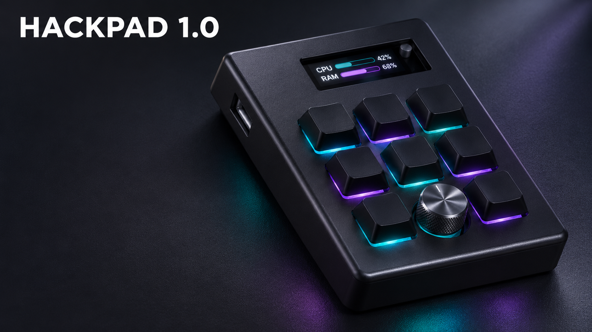

# Hackpad-1.0

This is by far my first project made completely from Tutorials and Guides on YouTube however I made some of the changes by seeking ideas from 2 old hack club events i.e. highway and statis from where I gathered more ideas and easy techniques to do so.

I basically made a hackpad consisting of 8 keys and 1 rotary encoder each having per key RGB and also an OLED screen to view various stats of PC its connected to like resource used etc

I have done the code on VsCode from some of my knowledge and some of ChatGPT

USE ANY KEYCAPS AND ENCODER KNOB OF YOUR CHOICE

## How To Assemble

> Solder all components on the PCB board carefully at its place,  wiring diagram is also shown below  in images section, visit if necessary

> Place the PCB on the desired spot on the Base part of the 3d printed case

> Now close the case by putting some doublesided tape on the poles that get inserted in the spot in the bottom part of the case

## How to Upload Firmware

Now since the assembling part is completed, we need to focus on the firmware part

> Connect the XIAO while a usb-c cable and connect it to your computer

> Use any microcontroller firmware uploading software like "Thonny" or "ArduinoIDE" and install micropython

> Copy and paste the firmware from the main.py or directly download and upload the file in the XIAO

> Upload the 2nd file also named as boot.py enabling Pc stats tramsfer over USB 

### REQUIREMEMTS

These modules are required to install the firmware and make it work 

> psutil
 
> pyserial

## Features And Operations 

**KEY1** — Copy (`Ctrl+C`)  
**KEY2** — Paste (`Ctrl+V`)  
**KEY3** — Undo (`Ctrl+Z`)  
**KEY4** — Cut (`Ctrl+X`)  
**KEY5** — Save (`Ctrl+S`)  
**KEY6** — Switch between open apps (`Alt+Tab`)  
**KEY7** — Go to the start of the current line (`Home`)  
**KEY8** — Open the system task manager (`Ctrl+Shift+Esc`)  
**EC11 single press** — Switch OLED page  
**EC11 double press** — Switch between volume and brightness mode  
**EC11 turn** — Adjust volume or brightness, depending on the selected mode  

## Pricing And BOM

Designator | Component | Selected part / description | Qty on PCB | Purchase pack |
|---|---|---|---:|---|
| MX1–MX8 | Mechanical key switches | [GranVela Outemu red, 3-pin linear, 45 g](https://www.amazon.in/GranVela-Red-Hot-Swappable-Equivalent-Keyboard-20/dp/B073WBY7J3) | 8 | $18.32 / 20 | $7.33 |
| LED1–LED8 | Addressable RGB LEDs | [Lonoa SK6812 MINI-E, 5 V](https://www.ubuy.co.in/productjp/QW0BOLVDC-lonoa-50pcs-sk6812-mini-e-rgb-same-as-ws2812b-sk6812-3228-pixels-led-chip-individually-addressable-full-color-dc5v) | 8 | $2.00 / 50 pcs (user estimate) | $0.32 (8 of 50 LEDs) |
| R1 | Resistor | [Electronic Spices 330 Ω, 1/4 W, ±5%, axial](https://www.amazon.in/Electronic-Spices-Tolerance-Through-Resistors/dp/B0BDG2F7FL) | 1 | $0.84 / 50 | $0.02 |
| U2 | OLED display module | [Robocraze 0.91 in blue, 128×32, I²C/IIC](https://www.amazon.in/dp/B084H9HLCS) | 1 | $2.94 / 1 | $2.94 |
| SW1 | Rotary encoder with push switch | [CentIoT EC11, 5-pin, 20 mm half shaft](https://www.amazon.in/dp/B0888RVZSN) | 1 | $2.63 / 2 | $1.31 |
| U1 | Controller module | [Seeed Studio XIAO RP2040, SKU 102010428](https://www.amazon.in/Microcontroller-Dual-Core-MicroPython-CircuitPython-Interfaces/dp/B09NNVNW7M) | 1 | $16.20 / 1 | $16.20 |
| PCB | Printed circuit board | Macropad PCB | 1 | $14.00 / 1 | $14.00

ESTIMATED TOTAL - `$54.5`

## Images

